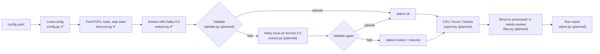
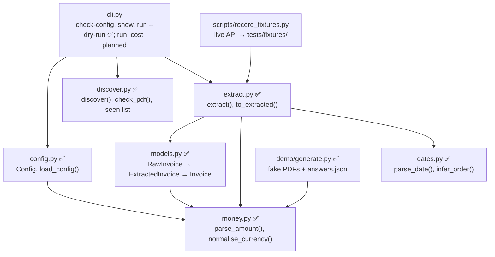
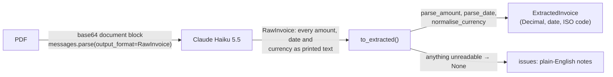
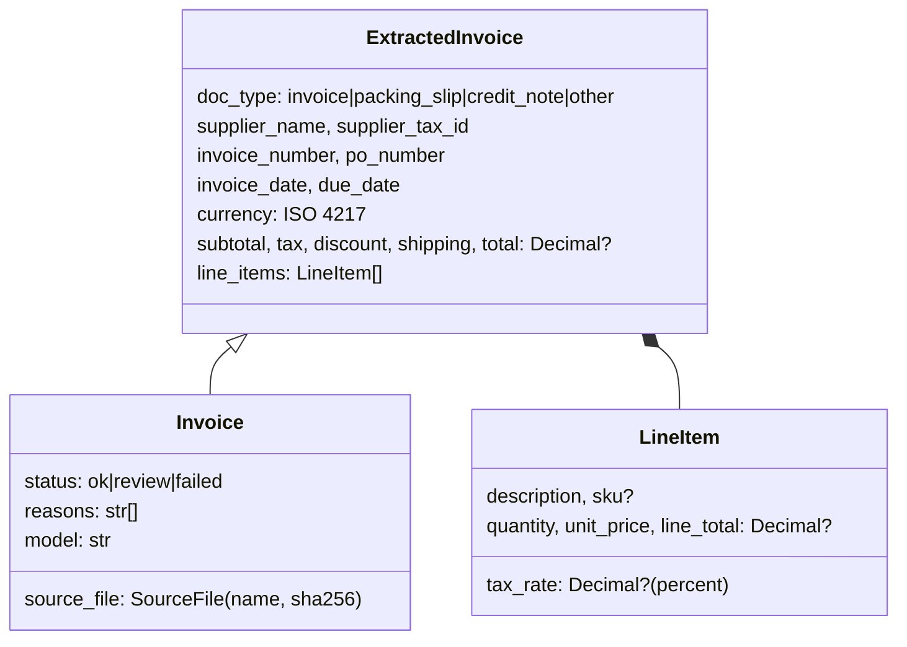

# Architecture

How Ibis is put together. Updated at the end of every build session; parts not built yet are
marked **planned**.

| Session | Scope | Status |
|---|---|---|
| 1 | Skeleton, config (E1), models, CLI shell (E11), CI, demo invoices + answer key | ✅ done |
| 2 | Discovery (E2), extraction (E3), recorded fixtures | ✅ done |
| 3 | Validation (E5), duplicates (E6), status and reasons (E7), escalation (E4) | planned |
| 4 | Exports (E8), file moves (E9), run report and cost (E12) | planned |
| 5 | Streamlit review page (E10), README, demo script | planned |

## The pipeline

Claude reads each document; Python checks the numbers. Only documents that pass every check
reach the sheet as `ok`.

## Modules

## Extraction: Claude reads, Python interprets

- **Why text, not numbers:** Claude copies; it never converts `1.299,00 €` or `09/20/2026`. All
  interpretation is in Python, testable and the same every time. The raw reply is kept on the
  `Extraction`, so every value traces back to what was printed.
- **Dates:** numeric dates are read in the document's own order (a part over 12 settles it for
  every date on the document); if nothing settles it, USD means month first, anything else day
  first, and an issue says the order was assumed.
- **Errors:** a problem with one document (refusal, cut-off reply, 5xx, rate limit, network) is
  `Extraction.error` and the run carries on. A problem that would hit every document (no key,
  rejected key, unknown model) raises `ApiSetupError` and stops the run.
- **Tests:** `tests/fakes.py` runs the real SDK client over a mock HTTP transport, so tests cover
  the actual request (document block, schema, prompt) and the SDK's parsing and error mapping,
  with no network. `tests/fixtures/` holds real recorded responses.

## Discovery

Every non-hidden file at the top of `input_dir` is either found or skipped with a reason: empty,
not a PDF (by content, not extension), password-protected, unreadable, no pages, too many pages,
too large for the API. Files are identified by SHA-256: hashes processed in earlier runs
(`output/.ibis/seen.json`, names and hashes only) are skipped, even under a new name. A byte-identical
file within one run is found but marked `duplicate_of`, so E6 can flag it without a second API call.

## Data model

`ExtractedInvoice` holds only what is printed, so it doubles as the schema Claude fills.
`Invoice` adds what the pipeline decides. Every `Invoice` starts as `review`; only validation
can make it `ok`.

## Currencies

Pluggable at three levels:

- **Config:** `validation.allowed_currencies` takes any ISO 4217 code; anything else on an
  invoice goes to review. `validation.currency_symbols` adds or remaps symbols per client.
- **Parsing:** `money.DEFAULT_SYMBOLS` (longest match first) plus the client overrides; an ISO
  code printed on the document beats a symbol.
- **Demo data:** `demo/generate.py --currencies` takes any ISO code; codes without a built-in
  style print as `XXX 1,234.00` with a generic 10% tax.

## Decisions

- Package `ibis_docs`, command `ibis` (the `ibis` import name belongs to ibis-framework).
- Demo-only dependencies (reportlab, pypdfium2, Pillow) live in a `demo` dependency group.
- Credit notes print negative quantities, so `qty × price = line total` holds for every
  document type without special cases.
- reportlab runs in invariant mode, so regenerating the demo set changes no bytes unless the
  generator changes; a test checks the committed PDFs match.
- Amounts, dates and the currency come back from Claude as printed text (`RawInvoice`) and are
  read in Python, not by the model.
- `pypdf` is the one PDF library at runtime, used only for encryption and page checks; Claude
  reads the content.
- Effort and thinking are left at Haiku 5.5's defaults until the accuracy run says otherwise.
