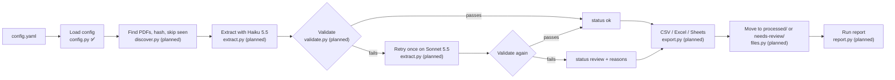
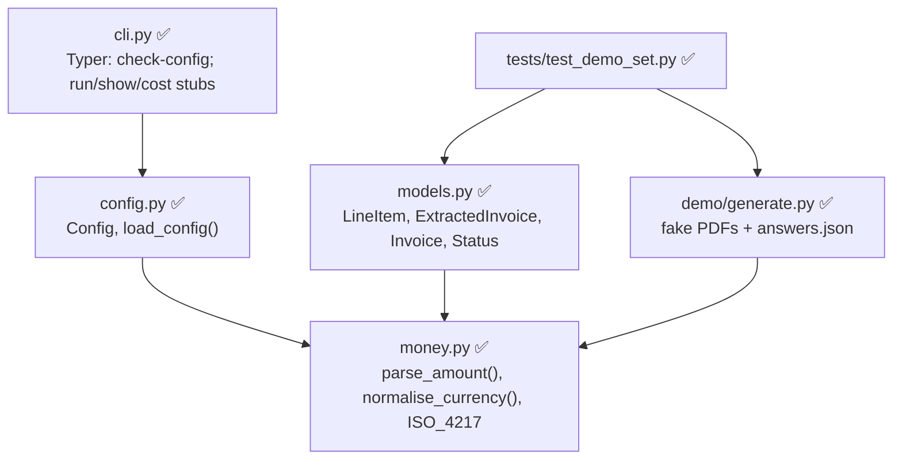
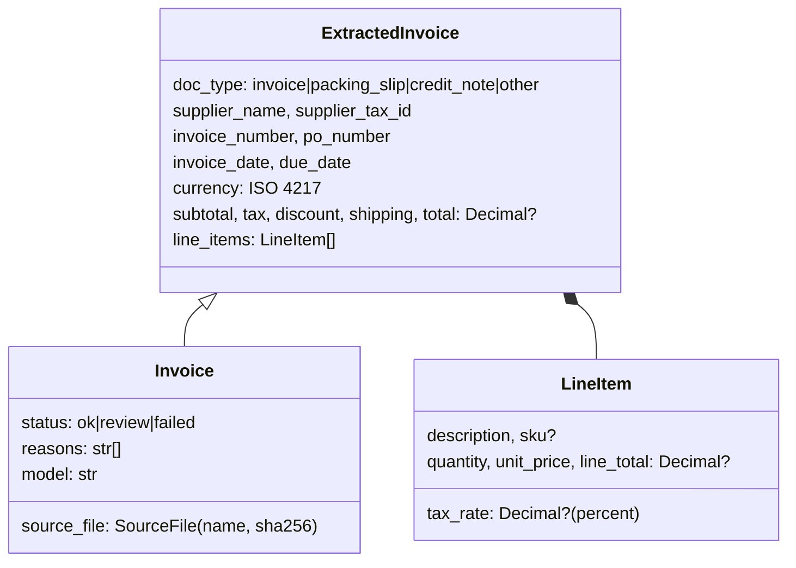

# Architecture

How Ibis is put together. Updated at the end of every build session; parts not built yet are
marked **planned**.

| Session | Scope | Status |
|---|---|---|
| 1 | Skeleton, config (E1), models, CLI shell (E11), CI, demo invoices + answer key | ✅ done |
| 2 | Discovery (E2), extraction (E3), recorded fixtures | planned |
| 3 | Validation (E5), duplicates (E6), status and reasons (E7), escalation (E4) | planned |
| 4 | Exports (E8), file moves (E9), run report and cost (E12) | planned |
| 5 | Streamlit review page (E10), README, demo script | planned |

## The pipeline

Claude reads each document; Python checks the numbers. Only documents that pass every check
reach the sheet as `ok`.

## Modules

## Data model

`ExtractedInvoice` holds only what is printed, so it doubles as the schema Claude fills.
`Invoice` adds what the pipeline decides. Every `Invoice` starts as `review`; only validation
can make it `ok`.

## Currencies

Pluggable at three levels:

- **Config:** `validation.allowed_currencies` takes any ISO 4217 code; anything else on an
  invoice goes to review. `validation.currency_symbols` adds or remaps symbols per client.
- **Parsing:** `money.DEFAULT_SYMBOLS` (longest match first) plus the client overrides; an ISO
  code printed on the document beats a symbol.
- **Demo data:** `demo/generate.py --currencies` takes any ISO code; codes without a built-in
  style print as `XXX 1,234.00` with a generic 10% tax.

## Decisions

- Package `ibis_docs`, command `ibis` (the `ibis` import name belongs to ibis-framework).
- Demo-only dependencies (reportlab, pypdfium2, Pillow) live in a `demo` dependency group.
- Credit notes print negative quantities, so `qty × price = line total` holds for every
  document type without special cases.
- reportlab runs in invariant mode, so regenerating the demo set changes no bytes unless the
  generator changes; a test checks the committed PDFs match.
